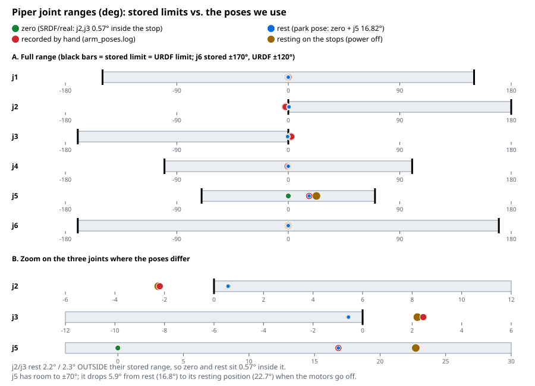

# piper-01: the arm on the `atlas` workstation

`piper-01` is a placeholder label: rename it when you choose a real one. Raw read-out: `piper-01.readout.json` (`tools/real_arm/arm_info.py`, 2026-10-14, nothing moved).

**This arm runs the latest firmware it supports (S-V1.9-1, upgraded 2026-10-14) and has been calibrated by the user.** The firmware-reported values below are the
reference for this arm; where the vendor URDF differs, the firmware value is used and the difference is listed in "Firmware vs vendor URDF". Older firmware
values are not kept.

| Item | Value |
|---|---|
| Label serial | **to record by hand from the arm's label** |
| Model / gripper | Piper standard / AgileX gripper, firmware-reported stroke **70 mm** (`max_range_config` 0.07 m; teaching range 100, friction 1) |
| Mounting | normal flat position (installation setting: flat). Payload setting: none (empty). Neither can be read back from the arm; both were set by the user. |
| USB-CAN adapter | candleLight (gs_usb), serial `002000295631511920313857`, appears as `can0` (1 Mbit/s) |
| Firmware / hardware | **S-V1.9-1** (latest supported) / H-V1.2-1, motor ratio/batch 10, node ARM_MC #15, date field 261014 (the day of the upgrade), unparsed 4-char field `30AH` |
| SDK profile | `v189` |

## Firmware vs vendor URDF (vendor URDF = `agx_arm_urdf` @ 680fa92, 2026-10-16)

| Value | Firmware (used) | Vendor URDF | Status |
|---|---|---|---|
| Joint 1-6 position limits | same as the URDF; j6 ±170° | j6 ±170° (changed from ±120° on 2026-10-13) | agree since the vendor update |
| Joint max speed | **3.0 rad/s** | 5 rad/s | **differ**: we use 3.0 (`config/firmware_values.yaml`) |
| Joint max acceleration | **5.0 rad/s^2** | not in the URDF | MoveIt uses 5.0 |
| Gripper stroke | **0.07 m** | 0.1 m (fingers 0.05 each) | **differ**: we use 0.07 (fingers 0.035 each) |
| Joint effort | not reported | 100 N.m (placeholder) | **differ**: we use the SDK's MIT torque range, ±16 N.m (joints 1-3) / ±13.012 (joints 4-6): an upper bound, not a rating |
| Link masses/inertias | not reported | CAD estimates | unmeasured, see `docs/description/MASSES.md` |

## Current state (2026-10-14, after the upgrade and the calibration)

- Role slave/feedback, CAN control, MOVE_J, teach off, error 0, all joints disabled, `motion_status` = "reach target failed" (0x1) with no error code (leftover flag).
- Slumped pose (powered off, deg) 0.10, -2.25, 2.21, -0.43, 22.72, 0.00; gripper width 0.14 mm. Drivers 23-24 V, 31-34 C, no fault bits.
- Stored limits: joint angle limits equal the vendor URDF (joint 6 +-170 deg); speed 3.0 rad/s, acceleration 5.0 rad/s^2 per joint;
  flange 1.0 m/s, 0.25 rad/s, 1.5 m/s^2, 0.3 rad/s^2.
- Crash protection **0 on every joint (no collision detection)**; assistance rating 0 on every joint.
- Bus: status/pose/joints/gripper 200 Hz, motor 100 Hz, driver 20 Hz; extra frames 0x1C0-0x1C3 (20-40 Hz; the SDK's Revo2 hand ids) and 0x212 (1 Hz, undocumented).
  Whether a Revo2 hand is attached or the firmware emits them is not established.
- Joints 2 and 3 are about -2 deg and +2 deg when powered off (the slumped pose), outside their stored ranges, also after calibration: the arm sags a little when the motors go off (the user's explanation, 2026-11-08).
  The vendor `piper_ros` README also says the DH parameters after S-V1.6-3 offset those two joint frames by 2 degrees (not confirmed with AgileX). Either way it only matters for leaving the slumped pose: see
  "Poses and the start / stop sequence" below.
- Enable test on S-V1.9-1 (2026-10-14): all six joints enabled, max drift 0.08 deg over 2.5 s, currents <= 0.08 A, status normal, clean disable. No motion has been commanded on the real arm yet.
- **First motion (2026-10-14, `tools/real_arm/arm_zero.py`, 50 % speed):** from the slumped pose (0.1, -2.2, 2.3, 0.0, 22.0, 0.0 deg) to the zero pose in 0.6 s (joint 5 moved 22 deg), final error 0.06 deg,
  final pose 0.0, +0.48, -0.44, 0.0, 0.0, 0.0 deg (joints 2/3 are aimed 0.5 deg inside their stored limit), no fault, clean disable. The path used was the SDK directly: CAN control + MOVE_J read back, speed 50 %, one `move_j`.
  Our ROS stack (`backend:=real`, command_guard, controllers) has not driven the arm yet.

- CPV drive parameters (read 2026-10-14 with `arm_info.py -c`): acceleration 5.0 and deceleration 5.0 rad/s^2 on every joint, profile velocity 0, position gain 5.0, velocity-loop kp 0.7 (joints 1-3) / 0.8 (joints 4-6), ki 40 (joints 1-3) / 80 (joints 4-6). Reading them put the arm in MOVE_CPV motion mode
  (the first `-c` version did not restore it; the fixed tool sets MOVE_J on the next `-c`, and any `move_j` switches it back).

## Poses and the start / stop sequence (user rule, 2026-11-08)

One word per thing:

| Word | Meaning | Who sees it |
|---|---|---|
| **zero** | the one valid start and end pose of every session: all joints 0, except joints 2 and 3 (limits at 0) held 0.01 rad inside. Computed, not typed: `piper_core.zero_pose(limits, margin)`; the SRDF, `initial_positions.yaml` and `arm_zero.py` must equal it (`test_named_poses`). | everyone |
| **slumped** | the pose a powered-off arm sags into: joints 2/3 about 2 deg outside their limits, joint 5 at about 22.7 deg. A measured fact (recorded above); never a target. | Piper Studio's control layers only |
| **park** | zero with joint 5 lowered 0.3840 rad (22.0 deg, chosen 2026-11-10, see "Park pose"), the last pose before power-off, so the arm drops less. SRDF group state `park`, hidden from `named_poses()`. | Piper Studio's control layers only |
| vendor zero | exact zeros (the vendor `move_home` and the GUI's "Go Zero"): on the limit of joints 2/3. We do not use it. | nobody |

Downstream users do two things: control the arm anywhere inside its limits, and return to `zero`. They call `Piper.start()` (CLI `piper start`) first and `Piper.stop()` (`piper stop`) last. They never command a slumped or park pose.

**`start()`** (real arm): enable the motors; if the arm is slumped, one move to zero by `command_guard`'s service `go_zero` (the only way out of the slumped pose: it accepts a slumped or zero arm only, sends zero once, waits until the measured state is at zero within 0.01 rad and stays there for 1 s, and answers success only then);
activate the controllers; if the arm is valid but not at zero, plan to zero; check zero again. Success means controllers active and the arm at zero. Simulators start at zero already, so `start()` just activates.
**`stop()`**: go to zero, check it, wait, go to park, wait, motors off; the arm sags into the slumped pose. A simulator stops at zero. An arm that is already slumped is left alone.
**The guard never lets anything out of the slumped pose:** `check_command` rejects every command while a measured arm joint is outside its limits (a stale command in ros2_control cannot pull a freshly enabled arm), and rejects any target outside the limits (a target closer than 0.01 rad to a limit is clamped to that margin). `activate()` refuses with `NOT_STARTED` on a slumped arm. MoveIt would refuse the same start state (`CheckStartStateBounds`: "Start state out of bounds", seen in the plumbing test).
Why zero is 0.01 rad inside: a pose exactly on a limit is rejected by planners and unreachable for the arm (it tracks a little short; the real arm ended 0.48 / -0.44 deg inside after a 0.57 deg aim). 0.01 rad is the guard's `limit_margin`, 7 times the 0.08 deg enable-test drift.
Verified on the real arm 2026-10-14 only with the SDK tool (`arm_zero.py`, one `move_j`, 0.6 s); the ROS path (`go_zero`, `start`, `stop`) is tested with the fake driver (`test_real_start_stop.py`) and not yet on the real arm.

## Park pose

**Current (2026-11-10, user at the arm, `tools/real_arm/arm_jog.py`):** `park` = zero with joint 5 = **22.0 deg (0.3840 rad)**, joints 2/3 0.01 rad inside their limits, so it is a pose the guard allows.
Holding the arm with j5 at 22.94 deg (motors on, no fault) left about 1 cm between the wrist and the support brackets; the gap cannot close because j2/j3 sit about 2.7 deg short of the stops.
22.0 deg is below both slumped j5 values seen (22.72 deg on 2026-10-14, 24.06 on 2026-11-10), so the target is never at or past where the arm rests. The earlier park (16.82 deg) is the first record below.
Not measured: the drop on disable from 22.0 deg (read `arm_joints.py` before and after the first `stop()`).
An earlier trial with `arm_zero.py --park-j5` ended with the arm dropping hard or hitting the case (user report 2026-11-10, cause not established); values above 22.5 deg are refused by the tool.

### First record (recorded by hand 2026-10-14)

Pose recorded with the motors off, wrist a few mm above the support brackets: joints (deg) 0.23, -2.19, 2.45, -0.42, 16.82, 0.0 (`arm_poses.log`). Against zero only joint 5 is lowered
(16.82 deg); joints 2/3 are at the stops (-2.19 / +2.45), which are outside the stored limits (j2 >= 0, j3 <= 0), so the pose cannot be commanded as recorded.
Flange height from the SDK's forward kinematics: slumped on the stops (j5 22 deg) 167.0 mm, recorded pose 174.3 mm, the same pose with joints 2/3 clamped inside their limits 189.2 mm, all joints 0: 213.3 mm.
The SRDF `park` therefore is zero with joint 5 = 0.2936 rad (16.82 deg), about 22 mm above the slumped pose; powering off there drops the wrist less than from zero (about 46 mm).
Verified 2026-10-14: the firmware accepts *leaving* the slumped pose (joints 2/3 at -2.2 / +2.3 deg, outside the stored range) with one `move_j` to a target 0.01 rad inside the limits. Not tested, and not needed: commanding a target past a stored limit (the vendor status code 4 "target angle out of range" is the likely reaction).

Joint ranges and where each pose sits: . Limit sources: the arm's stored limits (`get_joint_angle_vel_limits`, saved in `piper-01.readout.json`),
the official URDF `external/agx_arm_ros/.../piper/urdf/piper_description.urdf` (all six joints identical since the vendor update of 2026-10-13). Joint 5 has room to ±70°, so the park pose is not a limit: the wrist drops
from 16.8° to its slumped position at 22.7° when the motors go off.

## Decisions pending (nothing applied to the code base)

1. `speed_percent` for `backend:=real` is a launch argument (default 20); the value used for real runs is the user's to set. What 100 % corresponds to in rad/s is not documented.
2. Crash-protection level is 0 (no detection); changing it is a write to the arm, the user's decision.
3. Whether the arm has a Revo2 hand or another device on the bus (extra frames 0x1C0-0x1C3 are seen).
4. Joint torque rating: not reported by the firmware. The description uses the SDK's `move_mit` range (+-16 / +-13.012 N.m) as an upper bound; the real rating needs the vendor or a measurement.

## Hardware log 2026-11-10 (user present, hand on the power switch, 10 % speed)

- `arm_info.py`: read-out equals `piper-01.readout.json` (firmware S-V1.9-1, slave, MOVE_J, teach off, no faults). Slumped pose now 0.0, -2.14, 1.94, 0.0, 24.06, 0.0 deg (j5 was 22.72 on 2026-10-14): the sag varies by a degree or two. With motors off, motors 2, 3 and 5 report non-zero current/torque (j3 -4.8 N.m); last time all zero; cause not established.
- Speed calibration: at `speed_percent` 10 joint 5 moves about 16-17.5 deg/s (0.28-0.30 rad/s) in 5 runs, i.e. 10 % of the firmware 3.0 rad/s. 100 % = 3.0 rad/s is confirmed at 10 % only. Moves of 22-27 deg take 1.4-1.7 s; the last 0.5 deg settle within 0.1 s. Final error 0.05-0.07 deg every time; zero is reached at j2 +0.52..0.55, j3 -0.50..-0.62 deg (aim +-0.57).
- Poses on the arm through `arm_pose.py`: zero, park (j5 22.0 deg) and ready (j2 57.3, j3 -57.3, j5 57.3 deg) all reached; ready reads j3 -57.27, j5 57.33 deg.
- Park chosen: j5 22.0 deg (`arm_jog.py`: holding at 22.94 deg left a gap of about 1 cm to the support brackets). One `arm_zero.py --park-j5` trial the same day ended with the arm dropping hard or hitting the case (user report; which value and which moment are not recorded).
- Session routine `arm_session.py`: `start` from the slumped pose to zero (2.4-2.7 s), `stop` = zero, park, e-stop, reset, then `start` again at once: all worked. A first `stop` attempt printed "no joint/status feedback" (the status frame was read once without waiting; fixed to wait up to 5 s, cause on the bus not established).
- E-stop (`arm_stop.py` default and in `stop`): the arm lowers under damping and rests deeper than after a plain disable: 0.0, -2.0, 1.0, 0.0, 27.2, 0.0 deg. Status 1 during the e-stop; `reset()` clears it (status 0, motors disabled) without a power cycle, the arm keeps answering and `start` works right after.
- Not tested: `RealArm` (any method), `execute()` at 25 ms, gripper (read or write), speeds above 10 %, motion with a payload.
- Gripper (`piper-arm` keys, 2026-11-10, user present): open, close and 5 mm steps all work. An object of about 10 mm held at **9.4 mm** (width read-back) with command force 3.0 N; the measured force read **-2.05 N** (negative while gripping, about 68 % of the command). Repeated `-` steps with the object held only re-send the same target (4.4 mm): the squeeze is set by the command force, not the target. Not recorded yet: empty-closed width, open stroke and closing time, the force with the default 1.0 N, slip when the arm moves, whether commands work with the arm motors off, whether the arm e-stop affects the gripper.
- `RealArm` smoke test (`realarm_smoke.py`, 2026-11-10, 10 %, user present): all stages passed. status() before start: not started, no faults, feedback age 0.05 ms (the stale-feedback check does not false-alarm on real data). start() to zero, state read-back (gripper -0.4 mm, 0.008 N), guard refusals sent nothing (max joint change 0.000 deg), hold(), 5 deg move out and back (4.96 and 0.00 deg), 10 deg cosine on joint 1, gripper open/close, abort() stopped a slow run and held (6.59 deg), stop() = zero, park, e-stop, reset and status normal afterwards.
- Gripper, empty (same run): open to a 70 mm command reads **69.4 mm**; closed to a 0 mm command reads **0.1 mm** (so the empty-closed width is about 0 mm: a held object shows as a stalled close well above 1 mm). Force read-back with nothing in the gripper: +0.008 and +0.18 N open, -0.08 N closed (noise of about +-0.2 N; a grip is -2 N at 3 N commanded).
- Streaming 25 ms setpoints through `RealArm.execute` (`arm_stream_test.py`, joint 1, 10 deg cosine over 4 s, speed percent 6, user present). Tracking: `mode=fixed` lag 45 ms, rms 0.25 deg, max 0.43 deg; `mode=per_point` the same (0.26 / 0.44, no gain); **`lookahead=2` lag 0 ms, rms 0.04 deg, max 0.09-0.12 deg** (three repeats, ten runs in all); final error 0.00 deg in every run; final-pose repeatability 0.00 deg over 3 runs. Timing of the setpoints: late mean 0.3 ms, p95 0.4 ms, max 1.7 ms, spacing 25.0 +- 0.1 ms. Peak measured speed 0.172-0.182 rad/s against 0.137 planned and 0.18 nominal (6 % of 3.0 rad/s): between points the arm runs at its speed cap, so the speed percent bounds the real speed (10 % had given 0.28-0.30 rad/s before). Only joint 1, one slow plan, so far.
- Kinematics (`fk_compare.py --arm`): the flange pose the arm reports equals the SDK modified-DH kinematics to **0.00 mm** at zero and at `ready`, and our URDF is within **0.09 mm** of both (offline, 300 random poses: 0.09 mm and 0.000 deg). The model and the firmware agree.
- Bus lock: a second program was refused twice while `piper-arm` was open, naming the holder's pid.
- Not yet measured: joints 2, 3, 5 streaming, speeds above 6 %, a cuRobo Cartesian path, the dead-process drill, the gripper timing and slip, and everything on the ROS path.
- Streaming on other joints and at speed (`arm_stream_test.py`, `lookahead=2`, 2026-11-10, user present): joint 2 (8 deg, 5 %) lag 0 ms, rms 0.05 deg, max 0.11; joint 3 (-8 deg, 5 %) lag 0, rms 0.04, max 0.11; joint 5 (15 deg, 9 %) lag 5 ms, rms 0.07, max 0.35 deg (gravity shows a little). Joint 1 speed ladder: 22 % (peak 0.55 rad/s) lag 25 ms, rms 0.62 deg, max 1.06; 33 % (0.82 rad/s) lag 45 ms, rms 1.50, max 2.61; 44 % (1.10 rad/s) lag 65 ms, rms 2.96, max 4.72. Final error 0.00 deg and no fault or overshoot in all runs, measured peak speed equals the planned one. **The arm trails a streamed setpoint by about 35 ms + 73 ms per rad/s**, so a fixed lookahead of 2 (50 ms) only fits at low speed; `lookahead="auto"` follows the speed. The guard's 0.15 rad step from the measured pose limits full compensation to about 1.2 rad/s; `auto` backs off there. `auto` is not yet run on the arm.
- cuRobo scenario on the real arm (`run_scenario.py --backend real`, 2026-11-10, 0.3 rad/s, 1.0 N, user present): approach, grasp, close, lift, open, home all ok and back at zero in 49.8 s. Joint tracking per leg: max 0.33 / 0.20 / 0.17 / 0.28 deg (approach / grasp / lift / home), end error 0.09 / 0.09 / 0.05 / 0.08 deg. Gripper: open to 69.44 mm and close to 0.14 mm, each in about 0.6 s including the 0.3 s hold the check waits for. Wall time per leg is the plan time plus about 1.1 s (clock start and the 1 s the arrival must hold). Plan: TCP (0.25, 0, 0.05) m tool down, yaw 180 deg, cuRobo scene = a table plane at the base only; no object was in the gripper path. The report is in `~/data/ml/isaac/piper_studio/scenario/reports/`.
- ROS path on the real arm (`piper_real_driver`, first run 2026-11-10, user present, `speed_percent:=20`, `--speed 0.1`): `piper state` and `piper start` (twice) worked, `piper joints 0.1 0.5 -0.5 0 0.3 0 --duration 4` and `piper zero` succeeded, the gripper opened (`piper gripper 0.07`), `piper stop` (zero, park, e-stop, clear) and a second `start` worked. Failed: `piper status` printed nothing (cause unknown, no node log seen), `piper named ready` returned CONTROL_FAILED twice and was jerky, `piper gripper 0.0` returned STALLED although the gripper closed (the next command started from 0.14 mm); likely causes: the node publishes the gripper velocity as a constant 0.0 against the gripper controller's 0.5 s stall rule, and the 200 Hz position-streaming chain (trajectory controller, ros2_control, command_guard, node, firmware) against an arm whose firmware lags a streamed setpoint by 35-110 ms. Not measured. **Decision (user, 2026-11-10): the ROS path on the real arm is parked; `RealArm` is the supported interface.** Plan for later: CLEANUP C14.
- Gripper measurements (`gripper_test.py`, 2026-11-10, user present, arm started; full table and confidence in `docs/real_arm/REPORT.md`): empty, 5 cycles at 1 N: open **69.44 mm**, closed **0.14 mm**, both with 0.00 mm spread; close to within 1 mm in 0.28 s, open 0.26-0.36 s; time barely depends on force (0.34 s at 0.5 N, 0.26-0.28 s from 1 N). A plastic box (about 54 mm): stalled at 54.27 / 53.25 / 53.55 mm at 1 / 2 / 3 N, steady force -1.04 / -2.09 / **-2.09 N (a plateau near 2.1 N)**, impact peaks -2.9 / -5.0 / -6.2 N, the width relaxes +0.54 / +0.96 / +1.07 mm over 3 s. Held at 2 N while joint 1 moved 20 deg in 2 s (0.55 rad/s): the box was kept, the width changed +1.2 mm, the force dipped to -0.47 N (2 runs). User observations: the gripper does not move with the arm's motors off, and after `stop()` or an e-stop clear it cannot be moved with `o` / `l` until `s` (start); **the e-stop does not release a grip**. `RealArm.gripper_command` / `set_gripper` now refuse at once with that reason.
